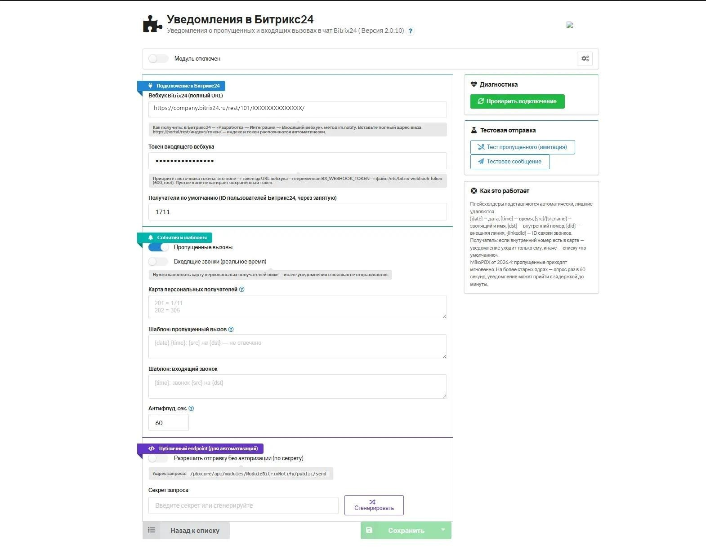

# ModuleBitrixNotify

**Уведомления MikoPBX в Битрикс24.** Модуль расширения MikoPBX: отправляет в
чат Битрикс24 уведомления о звонках через входящий вебхук (`im.notify`) —
пропущенные, входящие в реальном времени и произвольные сообщения через
REST API.



Версия `2.0.10` · GPL-3.0-or-later · PHP 8.4 · MikoPBX 2024.1.0+

[](https://github.com/kutyassistent-ops/MikoPBX_birix_notify/actions/workflows/ci.yml)

---

## Возможности

| Функция                     | Описание                                                                                                          |
| --------------------------- | ----------------------------------------------------------------------------------------------------------------- |
| Пропущенные вызовы          | Входящий внешний пропущенный на внутренний номер → уведомление. Внутренние↔внутренние пропущенные не отправляются |
| Входящие в реальном времени | Уведомление в момент звонка (AMI, событие `CdrConnector`), до ответа                                              |
| Персональные получатели     | Карта «внутренний номер = ID Битрикс24» (`201 = 1711`): уведомление уходит конкретному сотруднику                 |
| Получатели по умолчанию     | Список Битрикс24 user id                                                                                          |
| Шаблоны сообщений           | Плейсхолдеры `{date} {time} {src} {srcname} {dst} {did} {linkedid}`                                               |
| Антифлуд                    | Минимальный интервал между уведомлениями одному получателю (сек)                                                  |
| Публичный endpoint          | `POST /pbxcore/api/modules/ModuleBitrixNotify/public/send` по секрету — для Zabbix/скриптов/relay                 |
| Диагностика на странице     | Кнопки «Проверить подключение», «Тест пропущенного», «Тестовое сообщение»                                         |
| Интерактивный UI            | Панель диагностики: режим воркера, портал, источник токена, получатели                                            |

---

## Совместимость

`min_pbx_version` — **2024.1.0**. Против ядра MikoPBX проверено по тегам репозитория:

| Ядро | Режим | Задержка |
|---|---|---|
| ≥ 2026.4 (напр. 2026.5.6) | событие `WorkerCdr::FINALIZE_CDR_TUBE` | мгновенно |
| 2024.1 — 2026.3 | опрос CDR раз в 60 сек через `SELECT_CDR_TUBE` | до 1 мин |

`FINALIZE_CDR_TUBE` появился в ядре в ветке 2026.4 (в `2026.1.223` его ещё нет — проверено) — поэтому модуль сам определяет режим по константе ядра и на старых ядрах не «молчит», а опрашивает CDR по пингу SafeScripts.

Колонки CDR `src_name`/`dst_name` существуют с 2026.1; на более старых ядрах имя звонящего в уведомлении будет пустым — это штатно.

---

## Установка

1. Возьмите zip: [`dist/ModuleBitrixNotify-2.0.10.zip`](dist/ModuleBitrixNotify-2.0.10.zip).
2. Админка MikoPBX → **Модули расширения → Загрузить новый модуль** → выберите zip.
3. Включите модуль.

Настройки: **Настройки → Уведомления в Битрикс24** (пункт появляется в меню модулей после установки).

> [!warning] `module.json` должен лежать в корне архива
> Если модуль упакован в папку `ModuleBitrixNotify/`, установка падает с
> «module.json not found in the module archive».

### Как получить вебхук Битрикс24

1. Битрикс24 → **Разработчикам → Другое → Входящий вебхук**.
2. **Пользователь** — выберите сотрудника, от имени которого шлём уведомления.
3. **Права доступа** — отметьте **`im`** («Чат и уведомления»).
4. Скопируйте **полный URL** и вставьте в поле **«Вебхук Bitrix24 (полный URL)»**:
   `https://<портал>/rest/<индекс>/<токен>/` — портал, индекс и токен распознаются автоматически.

Альтернатива: портал можно вписать без `/rest/…`, а токен — в отдельное поле «Токен входящего вебхука». Приоритет источника — ниже.

Метод отправки — `im.notify` (form-urlencoded, по одному вызову на получателя). Значение токена никогда не печатается: ни в UI (поле `password`, не предзаполняется), ни в логах, ни в ответах REST.

### Приоритет источника токена

1. Поле «Токен» в настройках модуля;
2. токен из полного URL вебхука (поле «Вебхук Битрикс24»);
3. переменная окружения `BX_WEBHOOK_TOKEN`;
4. файл `/etc/bitrix-webhook-token` (600, root) на хосте MikoPBX.

Пустое поле на странице настроек **не затирает** сохранённый токен.

---

## REST API модуля

Защищённые роуты требуют Bearer JWT (учётные данные API создаются в админке: **Настройки → REST API / API Access Credentials**, создаёте ключ и подписываете запрос):

```bash
# Статус модуля
curl -H "Authorization: Bearer $KEY" https://<PBX>/pbxcore/api/modules/ModuleBitrixNotify/check

# Тестовое сообщение (по умолчанию получателям)
curl -X POST -H "Authorization: Bearer $KEY" https://<PBX>/pbxcore/api/modules/ModuleBitrixNotify/ping

# Произвольное сообщение
curl -X POST -H "Authorization: Bearer $KEY" -d "message=Обновление завершено" \
  https://<PBX>/pbxcore/api/modules/ModuleBitrixNotify/send

# Имитация пропущенного (прогоняет шаблон и маршрутизацию)
curl -X POST -H "Authorization: Bearer $KEY" -d "dst=201" \
  https://<PBX>/pbxcore/api/modules/ModuleBitrixNotify/test-missed
```

Публичный endpoint (включается тумблером + секрет, см. подробнее в [`docs/API.md`](docs/API.md)):

```bash
curl -X POST https://<PBX>/pbxcore/api/modules/ModuleBitrixNotify/public/send \
  -d "secret=$SECRET" -d "text=Backup finished" -d "uid=1711"
```

---

## Архитектура

```
{звонок} Asterisk
  ├─ AMI UserEvent CdrConnector ─► WorkerBitrixNotifyAMI ──► im.notify (момент звонка)
  └─ CDR завершение
       ├─ ядро ≥2026.4: FINALIZE_CDR_TUBE ─┬─► WorkerBitrixNotifyCdr ──► im.notify (пропущенный)
       └─ ядро <2026.4: poll CDR 60 сек ──┘

REST:
  /pbxcore/api/modules/ModuleBitrixNotify/{check,ping,send,test-missed}  → PbxExtensionsProcessor → moduleRestAPICallback (защищено JWT)
  /pbxcore/api/modules/ModuleBitrixNotify/public/{status,send}            → PublicGet/PostController → BitrixNotifyProcessor (секрет)
```

Код следует официальным паттернам: ModuleTemplate (структура/установка), ModuleTelegramNotify (AMI-воркер `CdrConnector`), MikoPBX-Development-Examples Pattern 2 (REST с дополнительными роутами).

---

## Структура репозитория

```
ModuleBitrixNotify/
├── App/
│   ├── Module.php                        точка входа модуля
│   ├── Controllers/                      обработчики страницы настроек
│   ├── Forms/                            форма настроек
│   └── Views/index.volt                  шаблон страницы настроек
├── Lib/
│   ├── BitrixNotifyConf.php              настройки
│   ├── BitrixNotifyMain.php              точка входа воркеров
│   ├── BitrixNotifySettings.php          провайдер настроек
│   ├── BitrixNotifyState.php             антифлуд и состояние
│   ├── BitrixRestApi.php                 вызовы REST Битрикс24
│   ├── BitrixTemplates.php               шаблоны сообщений
│   ├── WorkerBitrixNotifyAMI.php         воркер входящих (AMI)
│   ├── WorkerBitrixNotifyCdr.php         воркер пропущенных (CDR)
│   └── RestAPI/                          процессор REST и действия
├── Messages/                             локализация ru / en
├── Models/                               модель настроек
├── Setup/                                установка и обновление
├── public/assets/                        css и js страницы
├── docs/
│   ├── API.md                            HTTP API: параметры, ответы, примеры
│   ├── TROUBLESHOOTING.md                диагностика, типовые проблемы
│   └── screenshot-settings.jpg           скриншот страницы настроек
├── dist/                                 готовый zip для установки
├── CHANGELOG.md                          история версий
├── LICENSE                               GPL-3.0
├── composer.json
└── module.json
```

---

## Файлы документации

- [`docs/API.md`](docs/API.md) — HTTP API: параметры, ответы, примеры;
- [`docs/TROUBLESHOOTING.md`](docs/TROUBLESHOOTING.md) — диагностика, типовые проблемы;
- [`CHANGELOG.md`](CHANGELOG.md) — история версий.

---

## Известные особенности

> [!warning] `im.notify` берёт одного адресата
> Список получателей через запятую Битрикс не понимает. Модуль делает
> отдельный вызов на каждого, поэтому сообщение уходит столько раз,
> сколько получателей.

> [!warning] HTTP 200 не значит доставку
> Битрикс отвечает `200` с `result: false`, если ID неверен или запрещены
> сообщения от приложений. Модуль разбирает тело ответа, а не код.

> [!info] Токен никогда не печатается
> Поле в UI — `password`, оно не предзаполняется, в логи и в ответы REST
> токен не попадает. Пустое поле при сохранении **не затирает** уже
> сохранённый токен.

> [!info] Режим воркера выбирается по версии ядра
> На ядрах от 2026.4 уведомление о пропущенном уходит по событию
> `FINALIZE_CDR_TUBE` — мгновенно. На более старых ядрах модуль опрашивает
> CDR раз в 60 секунд, поэтому задержка может достигать минуты.

> [!note] На старых ядрах нет имени звонящего
> Колонки `src_name` / `dst_name` в CDR появились в 2026.1. На более старых
> ядрах имя звонящего в уведомлении будет пустым — это штатно.

> [!note] Внутренние звонки не считаются пропущенными
> Уведомление уходит только при входящем **внешнем** пропущенном на
> внутренний номер. Внутри­ренние↔внутренние пропущенные игнорируются.

> [!info] Антифлуд работает по получателю
> Между двумя уведомлениями одному и тому же получателю выдерживается
> пауза (`throttle_sec`). Это гасит лавину при массовом падении линий.

> [!warning] MikoPBX превращает любой PHP-warning в исключение
> Оператор `@` это не подавляет. Поэтому все обращения к файловой системе и
> `curl` в модуле обёрнуты в проверки и `try/catch` — иначе воркер падал бы
> на ровном месте.

> [!info] Публичный endpoint выключен по умолчанию
> `POST /public/send` работает только если включён тумблер и задан секрет.
> Без этого маршрута нет.

> [!warning] `module.json` должен лежать в корне архива
> Если модуль упакован в папку `ModuleBitrixNotify/`, установка в MikoPBX
> падает с «module.json not found in the module archive». В CI раскладка
> готового архива проверяется автоматически.

---

## Проверка в CI

На каждом пуше:

- `php -l` по всем PHP-файлам модуля;
- проверка раскладки готового архива в `dist/`: `module.json` в корне и
  отсутствие записей с обратными слэшами.

---

## Проверено / не проверено

**Проверено на живой АТС (MikoPBX 2026.5.6):**
- рендер страницы настроек, тумблеры, сохранение формы штатной кнопкой;
- разбор полного вебхук-URL (`webhookUrlMode: true`, индекс приложения);
- доставка `im.notify` в Битрикс24 (тестовое сообщение и имитация пропущенного — `ok:true`);
- диагностика `check` (`workerMode: finalize`, `tokenSource: settings`);
- обновление модуля между версиями 2.0.x без потери настроек.

**Проверено по исходникам ядра (тег 2026.5.6 и ранее):**
- константы очередей воркера, хуки `ConfigClass`, `Util::sysLogMsg` сигнатура;
- механизм дополнительных роутов `getPBXCoreRESTAdditionalRoutes` (RouterProvider + `thisIsModuleNoAuthRequest`);
- схема установки: `createSettingsTableByModelsAnnotations` диффит аннотации → добавляет новые колонки при обновлении модуля.

**Не проверено:**
- `php -l` всех файлов (PHP CLI на машине сборки отсутствует); на АТС модуль исполняется без ошибок;
- живой пропущенный звонок (синтетический тест работает, CDR-воркер запущен);
- обновление с 1.x на 2.0 на копии (механизм проверен по исходникам ядра).

---

## Связанные проекты

| Проект | Роль |
|---|---|
| [`grafana-bitrix-relay`](https://github.com/kutyassistent-ops/grafana-bitrix-relay) | Доставка алертов из Grafana в Битрикс24 — тем же методом `im.notify` |
| [`grafana-dashboards`](https://github.com/kutyassistent-ops/grafana-dashboards) | Дашборды и правила алертинга |
| [`MikoPBX_Prometheus`](https://github.com/kutyassistent-ops/MikoPBX_Prometheus) | Экспортёр метрик MikoPBX в формате Prometheus |

---

## Лицензия

GPL-3.0-or-later — полный текст в [LICENSE](LICENSE).
